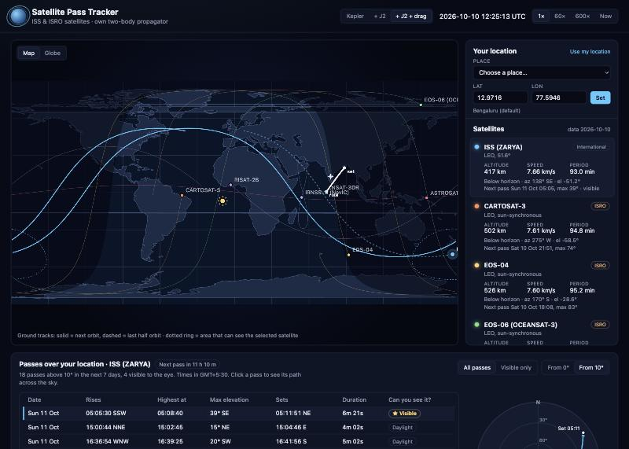

# Orbit Track: Satellite Pass Tracker

Predicts when the International Space Station and seven ISRO satellites pass over any location,
and whether you can see them, using an orbit propagator written from scratch. It then measures how far
that propagator drifts from the industry-standard SGP4 model and from NASA's own ISS trajectory, and
checks the predictions against Heavens-Above.

**Live demo: https://arjunrb0.github.io/Orbit-Track/**



## What it does

- Downloads live orbital data (CelesTrak OMM/JSON) and NASA's ISS trajectory once a day with a scheduled
  GitHub Action.
- Propagates each orbit with a **two-body (Kepler) model**, plus the **J2 secular correction** for
  Earth's equatorial bulge and a **drag term** from the element set's own ṅ. All written from scratch:
  no orbital libraries.
- Converts positions through the time and coordinate frames needed for observers: Julian
  date → sidereal time → Earth-fixed → latitude/longitude, and East-North-Up → azimuth/elevation.
- Lists upcoming passes over your location (rise, highest point, set, directions) and flags the ones
  you can **see with the naked eye** (satellite sunlit, your sky dark), with an estimated **brightness**
  for the ISS. Elevations include **atmospheric refraction**. Includes a sky plot, ground tracks on a world
  map with day and night, and a 3D orbit view.
- Shows, for each satellite, how far the propagator drifts from SGP4 over a week, and for the ISS how far
  both drift from **NASA's own trajectory**.

[satellite.js](https://github.com/shashwatak/satellite-js) (SGP4) is used **only as a reference**
to measure the from-scratch propagator against.

## Results

Full tables for every satellite: [docs/RESULTS.md](docs/RESULTS.md) (generated by `npm run compare`).

**Position error compared with SGP4**, worst error within each window, from the element-set epoch
(element sets of 10 October 2026):

| | 1 day | 1 week |
|---|---|---|
| Low orbits, pure Kepler | 414–868 km | 2,875–5,916 km |
| Low orbits, Kepler + J2 | 12–18 km | 29–155 km |
| Low orbits, Kepler + J2 + drag | 11–18 km | 15–47 km |
| Geosynchronous, Kepler / + J2 | 27–33 km | 27–60 km |

**ISS position compared with NASA's own trajectory** (the [ISS ephemeris](https://nasa-public-data.s3.amazonaws.com/iss-coords/current/ISS_OEM/ISS.OEM_J2K_EPH.txt)
NASA publishes, converted from J2000), worst error within each window, element set of 9 October:

| | ≤ 1 day | ≤ 3 days | ≤ 7 days |
|---|---|---|---|
| SGP4 (satellite.js) | 9.4 km | 21 km | 60 km |
| Kepler + J2 (from scratch) | 19 km | 19 km | 89 km |
| Kepler + J2 + drag (from scratch) | 21 km | 33 km | 69 km |
| Pure Kepler (from scratch) | 454 km | 1,369 km | 3,170 km |

**ISS pass predictions over Bengaluru vs [Heavens-Above](https://www.heavens-above.com)**
(27 passes, 10–20 October 2026, same element set):

| Propagator | Passes found | Within 1 minute | Worst error, day 1 → day 10 |
|---|---|---|---|
| SGP4 + this project's pass search and coordinate code | 27/27 | 27/27 | 1 s → 1 s |
| Kepler + J2 + drag (from scratch) | 27/27 | 27/27 | 2 s → 3 s |
| Kepler + J2 (from scratch) | 27/27 | 27/27 | 2 s → 40 s |
| Pure Kepler (from scratch) | 8/27 | 5/27 | (most passes missed) |

**Visible-pass labels** (visible / daylight / in Earth's shadow) match Heavens-Above for **27 of 27** passes.
For the 4 visible passes, the moments the ISS enters or leaves Earth's shadow match to **within 2 s**, and the
estimated brightness to **within 0.7 magnitudes**.

What the numbers mean:

- **Pure Kepler is unusable after a few hours in low orbit.** Earth's bulge (J2) swings the ISS's
  orbital plane round by about 5° per day and changes the orbital period slightly.
- **Adding J2's secular drift closes over 95% of the gap** to SGP4 for low orbits. The J2 rates
  agree with SGP4's own internal rates to within 0.1–0.7%.
- **Against reality, the simple models hold up.** Compared with NASA's own ISS trajectory, the J2 models
  land between 0.9× and 2.7× SGP4's own error over a week. SGP4 is clearly better in the first hours,
  thanks to short-period terms these models leave out. (At 3 days J2 alone briefly looks *better* than SGP4,
  but that's a coincidence: its along-track error happens to pass through zero then, on its way from +6 km at the start
  to −59 km by day 6. See [the breakdown](docs/RESULTS.md#against-nasas-actual-iss-trajectory).)
- **A growing study, not one snapshot.** One element set can't separate skill from luck, so the daily
  GitHub Action now archives every ISS element set and NASA ephemeris and re-measures all of them against
  the freshest NASA data. Results become final once the NASA data used is at most 4 days old. The live
  chart is on the site (ISS → Accuracy → vs NASA trajectory); it started on 10 October 2026 and grows
  by about one element set a day.
- **Drag: a lesson in choosing the yardstick.** Against SGP4, adding the element set's ṅ drag term cut the
  ISS's 1-week error tenfold (155 km → 15 km). Against NASA's trajectory it doesn't: J2 alone ends 89 km
  *behind* the real ISS and J2 + drag 46 km *ahead*, because the ṅ (like SGP4's own drag) overestimated that
  week's drag. Agreeing with SGP4 is not the same as agreeing with reality.
- **Pass times are forgiving.** 150 km of along-track error is only ~20 s at 7.7 km/s. With drag, the
  predictions stay within 3 s of Heavens-Above (which uses SGP4) for all 10 days.
- **Low and high orbits are different regimes.** At the ISS, J2 is ~10,000× stronger than the Moon's pull,
  so J2 + drag captures almost everything. At geostationary height J2 is 38× weaker relative to gravity
  and the Moon's tidal pull is about as large as J2 itself. A J2-only model is therefore incomplete there,
  and the corrections don't reliably help (plain Kepler is already within 27–60 km after a week, only
  0.04–0.1° as seen from the ground). Full analysis with a force-by-force table:
  [Low orbits vs high orbits](docs/RESULTS.md#low-orbits-vs-high-orbits).
- **The first row of the pass table tests everything except the propagator.** Heavens-Above uses
  SGP4, so feeding SGP4 positions through this project's sidereal time, frame conversions, look
  angles and pass search reproduces its list to the second.

## Limitations (honest)

- **SGP4 is a yardstick, not the truth.** Against NASA's trajectory it was 5 km off at epoch and 60 km
  after a week.
- **NASA's trajectory is a prediction too.** Comparing 52 archived NASA files with each other shows their
  predictions drift by a median of 3–5 km at 1–4 days old, rising to ~40 km at 9 days. The one-week NASA
  comparison used a file that was up to 9 days old by the end, so its 7-day numbers carry tens of km of
  uncertainty. (The daily study avoids this by only using fresh NASA data.)
- **The study is young.** Until a few weeks of final results exist, treat its medians as preliminary.
- **Not modelled:** J2's short-period terms, higher harmonics (J3, J4), the Sun's and Moon's gravity.
  Drag is a simple constant-ṅ term taken from the element set, not a physical atmosphere model. For
  geosynchronous orbits J2 alone gives mixed results (it improves IRNSS-1I but makes INSAT-3DR worse),
  because SGP4's deep-space mode includes lunisolar terms that partly cancel J2.
- **Element-set errors:** CelesTrak elements are SGP4 *mean* elements, not a true snapshot of the
  orbit, so even at the epoch the from-scratch models are 3–28 km from SGP4.
- **Earth rotation** uses UTC in place of UT1 (up to ~0.4 km ground error) and ignores polar motion.
- **Visibility and brightness are approximate.** The shadow model is a spherical Earth with no penumbra
  or atmosphere. Brightness treats the ISS as a matt sphere with an assumed standard magnitude of −1.8,
  good to about ±0.7 magnitudes; it isn't available for the ISRO satellites (no published standard
  magnitude). Refraction uses standard conditions (10 °C, 1010 hPa).
- **Visibility labels follow the listed pass.** Heavens-Above labels the whole pass down to 0°; the app
  labels the part above your chosen minimum elevation. This differs for one of the 27 test passes.
- **One snapshot:** results are for one element set per satellite. A fuller study would repeat this
  over many dates.

## How it was validated

Every module is tested against **independent** references, not against its own derivation:

| What | Checked against |
|---|---|
| TLE/OMM parsing | Real TLE checksums; Vanguard 1 test case (Vallado et al. 2006); OMM vs TLE of the same element set |
| Kepler's equation, elements → position/velocity | Vallado *Fundamentals of Astrodynamics* Examples 2-1 and 2-6; energy and angular momentum conservation |
| Propagator dynamics | Direct numerical integration of Newton's law (RK4): agrees to 0.01 mm after 6 h |
| Orbital period | Measured from the Newton integration vs Kepler's third law: agrees to < 0.01 s |
| Julian date, sidereal time, frames | Vallado Examples 3-3, 3-4, 3-5; Vallado (2006) TEME example to 0.1 m; WGS-84 polar radius |
| Ground tracks | Max latitude = inclination; westward shift per orbit = Earth's rotation in one period |
| J2 model | SGP4's internal un-Kozai mean motion (to 1e-10) and secular rates; ISS node rate ≈ −5°/day; sun-synchronous rate 0.9856°/day |
| Drag term | ISS 1-week error vs SGP4 cut tenfold; no effect on deep-space orbits |
| Pass prediction | Heavens-Above (27 passes); geometric maximum pass duration; geostationary elevation formula |
| Sun position | 2026 March equinox and June solstice (declination), perihelion and aphelion (distance) |
| Earth's shadow, visibility | satellite.js shadow function (outside penumbra); Heavens-Above labels (27/27) and shadow entry/exit times (within 2 s) |
| TEME → J2000 (precession, nutation) | Vallado et al. (2006) worked example, to under 1 m |
| Positions vs reality | NASA's ISS ephemeris: SGP4 and NASA agree to ~0.1 km radially and cross-track at epoch (frames check) |
| The reference itself | NASA's predictions vs its own later files (52 archived ephemerides) |
| Study bookkeeping | Archive deduplication, newest-NASA-file-wins splicing, final vs provisional windows |
| Refraction | Standard values: 34′ at the horizon, ~5.3′ at 10°, ~1′ at 45° |
| Brightness | Inverse-square and phase-law checks; Heavens-Above magnitudes (within 0.75) |

80 tests run with Node's built-in test runner. A failing test blocks deployment. Bugs found along the
way, and how they were caught, are recorded in the [development log](docs/LOG.md).

## How it works

```
CelesTrak ──(daily GitHub Action)──▶ public/data/omm.json
                                        │ parse (src/data/elements.js)
                                        ▼
               mean elements at epoch: n, e, i, Ω, ω, M
                                        │ two-body + J2 propagator (src/orbit/kepler.js, j2.js)
                                        ▼
               position & velocity in the TEME inertial frame
                                        │ sidereal time, frames (src/orbit/time.js, frames.js)
                                        ▼
         latitude/longitude (map)  ·  azimuth/elevation for an observer
                                        │ scan + bisection + golden-section (src/passes/passes.js)
                                        ▼
                 pass list, sky plot, ground tracks (src/ui/)

satellite.js SGP4 ──▶ reference for measuring error (src/analysis/compare.js)
```

The key steps:

1. **Kepler's equation** `M = E − e sin E` has no algebraic solution, so it is solved with Newton's
   method. The slope `1 − e cos E ≥ 1 − e > 0` guarantees exactly one root.
2. **True anomaly** from the auxiliary-circle geometry: `ν = atan2(√(1−e²) sin E, cos E − e)`.
3. **Position and velocity** in the orbit's own plane, then three rotations (ω, i, Ω) into space.
4. **J2 secular drift:** the node regresses at `−(3/2) n J2 (R/p)² cos i`, and the perigee and mean
   anomaly drift similarly. SGP4's "un-Kozai" mean-motion conversion is applied first.
5. **Drag:** the element set's ṅ/2 adds `2π (ṅ/2) Δt²` to the mean anomaly as the orbit sinks
   and speeds up (low orbits only).
6. **Earth rotation:** rotate by Greenwich Mean Sidereal Time (IAU-82) into Earth-fixed coordinates.
   Latitude on the WGS-84 ellipsoid is found iteratively.
7. **Passes:** scan elevation every 60 s, bisect each horizon crossing to 0.1 s, golden-section
   search for the highest point, and refine near-miss peaks so grazing passes aren't skipped.
8. **What you see:** atmospheric refraction lifts objects near the horizon (Sæmundsson's formula). A
   satellite's brightness is estimated from its range and phase angle, treating it as a matt sphere.
9. **Visibility:** the Sun's position from the *Astronomical Almanac* low-precision formula. A satellite
   is in shadow when, seen from it, the Sun's centre is behind Earth's disc (angle < asin(R/r)). A pass is
   visible when the satellite is sunlit while the Sun is more than 6° below the observer's horizon.

## Satellites

| Satellite | NORAD | Orbit |
|---|---|---|
| ISS (Zarya) | 25544 | Low Earth orbit, 51.6° |
| Cartosat-3, EOS-04, EOS-06 (Oceansat-3) | 44804, 51656, 54361 | Sun-synchronous, ~500–740 km |
| RISAT-2B | 44233 | Low Earth orbit, 37° |
| AstroSat | 40930 | Low Earth orbit, 6° (near-equatorial) |
| INSAT-3DR | 41752 | Geostationary |
| IRNSS-1I (NavIC) | 43286 | Inclined geosynchronous, 29° |

## Running locally

Requires Node.js 22 or newer.

```bash
npm install
```

```bash
npm run dev
```

Other scripts: `npm test` (test suite), `npm run build` (production build into `dist/`),
`npm run fetch-data` (download fresh elements from CelesTrak and NASA), `npm run study` (update the
accuracy study), `npm run nasa-consistency` (measure NASA's own prediction drift from its archive), and
`npm run compare` (regenerate [docs/RESULTS.md](docs/RESULTS.md)).

## Project structure

```
src/data/       TLE/OMM parsing, satellite catalogue, coastline decoding
src/orbit/      constants, vectors, Kepler propagator, J2 and drag, time, frames, precession, Sun and shadow
src/passes/     pass prediction, refraction and brightness
src/analysis/   comparison against SGP4
src/ui/         map, 3D globe, pass panel and sky plot, accuracy chart
scripts/        daily data fetch, accuracy study, SGP4 comparison report, NASA consistency check
data/history/   archived ISS element sets and spliced NASA trajectory (grows daily)
tests/          80 tests, with fixtures (ISS element set, Heavens-Above passes, NASA ISS ephemeris)
docs/           results, development log
.github/        CI: test → build → deploy to Pages; daily data update
```

## Orbital data formats

CelesTrak publishes the same elements in two formats:

- **TLE (two-line element set):** a 1960s punched-card format, two fixed-width 69-character lines
  with implied decimal points, two-digit years and a checksum digit. Catalogue numbers are limited
  to five digits.
- **OMM (Orbit Mean-Elements Message):** the CCSDS standard, here in JSON. Same content, named
  fields, more precision (e.g. ISS eccentricity 0.00067745 in OMM vs 0.0006774 in the TLE).

The app uses OMM. TLEs are also saved and cross-checked against the OMM data on every fetch.

## Credits

- Orbital data: [CelesTrak](https://celestrak.org) (T. S. Kelso).
- SGP4 reference: [satellite.js](https://github.com/shashwatak/satellite-js).
- Coastlines: [Natural Earth](https://www.naturalearthdata.com) via
  [world-atlas](https://github.com/topojson/world-atlas).
- Pass validation data: [Heavens-Above](https://www.heavens-above.com).
- ISS trajectory: NASA Johnson Space Center (ISS OEM ephemeris).
- Methods and test cases: D. A. Vallado, *Fundamentals of Astrodynamics and Applications*; Vallado,
  Crawford, Hujsak & Kelso (2006), "Revisiting Spacetrack Report #3"; Hoots & Roehrich (1980),
  Spacetrack Report #3; J. Meeus, *Astronomical Algorithms* (refraction).
